<div align="center">


# GcGames

**Un casino online para jugar con tu gente.** Mesas en vivo, rondas para todos a la vez, juegos en solitario, gacha de
cartas y una economía semanal con su propia Hacienda. Todo con dinero de mentira y sin servidor propio.

[](https://play.gcgames.workers.dev)


<br>

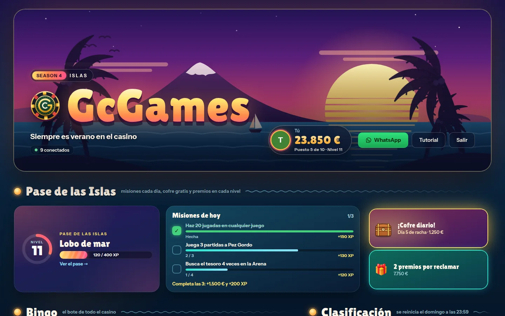

</div>

---

## Índice

- [Qué es](#-qué-es)
- [Capturas](#-capturas)
- [Juegos](#-juegos)
- [Por dentro](#-por-dentro)
- [Estructura](#-estructura)
- [Puesta en marcha](#-puesta-en-marcha)
- [Publicar](#️-publicar)
- [Base de datos](#️-base-de-datos)
- [Cuentas y administración](#-cuentas-y-administración)
- [Seguridad](#-seguridad)
- [Límites del plan gratuito](#-límites-del-plan-gratuito)

---

## 🎲 Qué es

GcGames es un casino con dinero ficticio para un grupo cerrado. Cada jugador empieza la semana con **15.000 €**; el
domingo a las 23:59 (hora de Canarias) se reinician los saldos y se guarda el podio de la semana.

- **Mesas en vivo** de blackjack, póker y ajedrez (uno contra uno, con apuesta), con chat, globos de mensaje y enlaces
  de invitación.
- **Rondas para todos a la vez**: ruleta, cohete, carrera, ascensor, subasta y bingo. Todo el casino ve la misma ronda.
- **Juegos en solitario** contra la casa, que sortea el servidor: nadie puede hacer trampas desde el navegador.
- **Score** semanal con la evolución día a día y lo que cada uno tiene fuera del saldo (cartas, inmuebles, Suiza).
- **Economía**: gacha de cartas coleccionables de Black Clover (con uniones que se forman juntando dos cartas y casa de empeños), una Inmobiliaria con tablero y 168 propiedades en las 7 islas (cada una con su tablero y su ciudad), una Cuenta en Suiza
  para esconder dinero y **Hacienda**, que reclama su parte a los que más tienen.
- **La banca**: el master puede dar dinero, mandar avisos, activar el *Admin Abuse* (×2, ×3 o todo gratis), abrir el
  bote del bingo, lanzar redadas de Hacienda, aceptar cuentas nuevas y dar contraseñas temporales.
- **Temporadas**. Ahora mismo, la **Season 4 · Islas**: todo el casino al atardecer en Canarias y el **Pase de las
  Islas**, con XP por jugada, tres misiones cada día, un cofre diario con racha y 30 niveles con premios y títulos.
- **App instalable** en el móvil (PWA), diseño adaptado a pantallas estrechas y tema de Halloween en fechas.

## 📸 Capturas

<table>
  <tr>
    <td width="50%">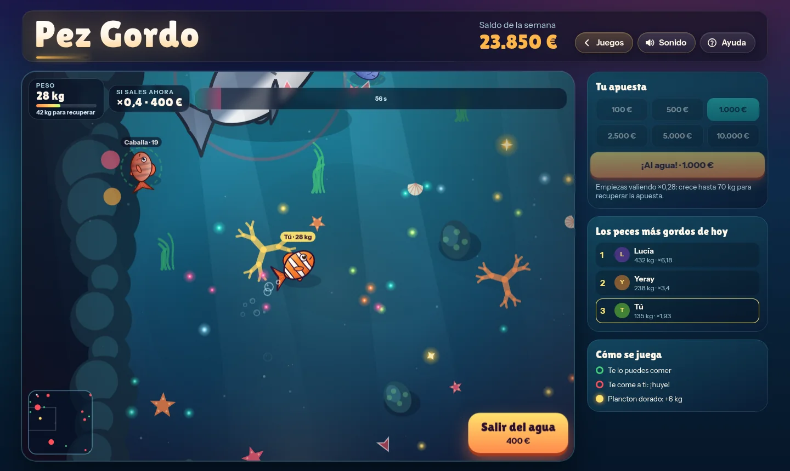</td>
    <td width="50%">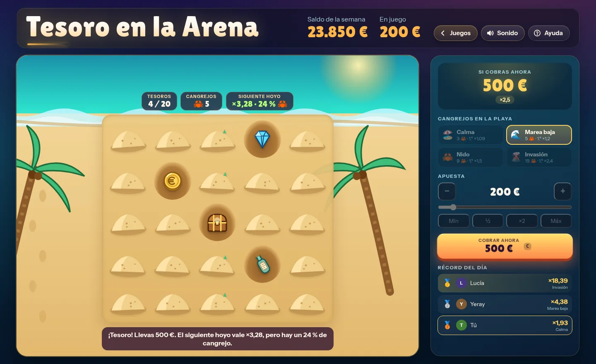</td>
  </tr>
  <tr>
    <td align="center"><b>Pez Gordo</b> · come, crece y sal del agua antes de que te coman</td>
    <td align="center"><b>Tesoro en la Arena</b> · cava sin despertar a un cangrejo</td>
  </tr>
  <tr>
    <td>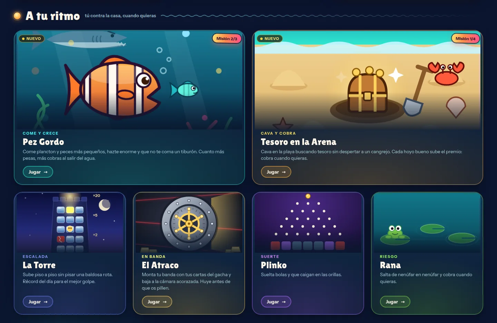</td>
    <td>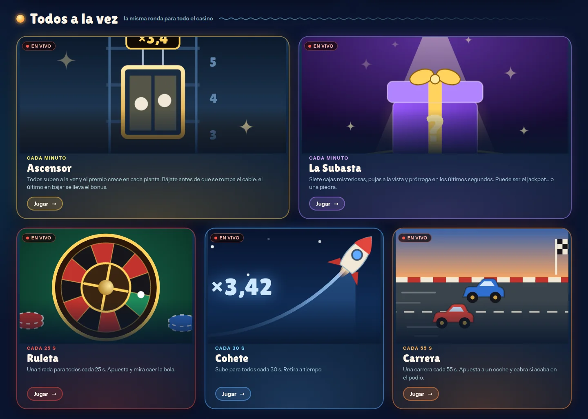</td>
  </tr>
  <tr>
    <td align="center">Juegos en solitario</td>
    <td align="center">Rondas para todo el casino</td>
  </tr>
  <tr>
    <td>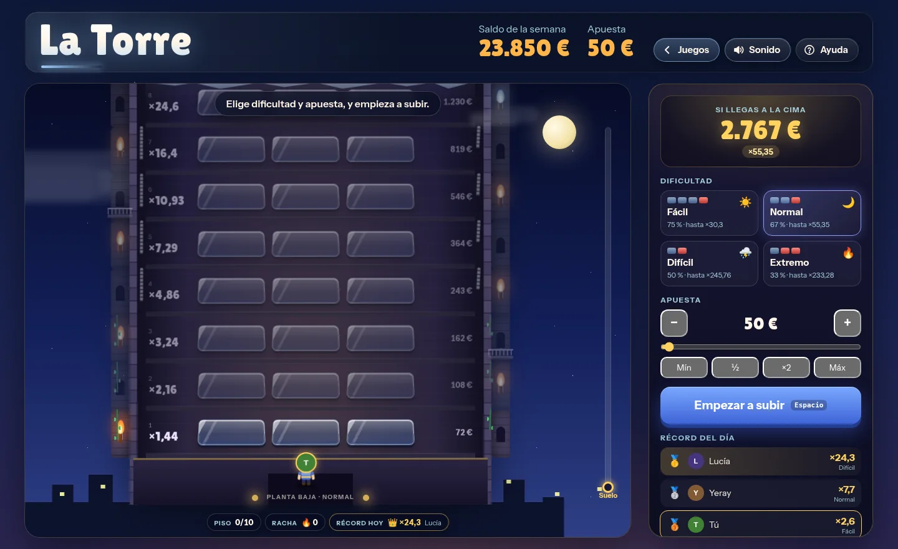</td>
    <td>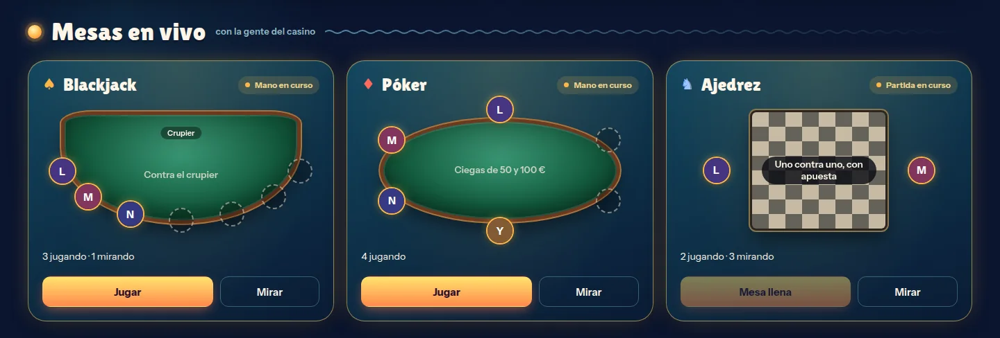</td>
  </tr>
  <tr>
    <td align="center"><b>La Torre</b> · sube piso a piso sin pisar una baldosa rota</td>
    <td align="center">Mesas en vivo</td>
  </tr>
  <tr>
    <td>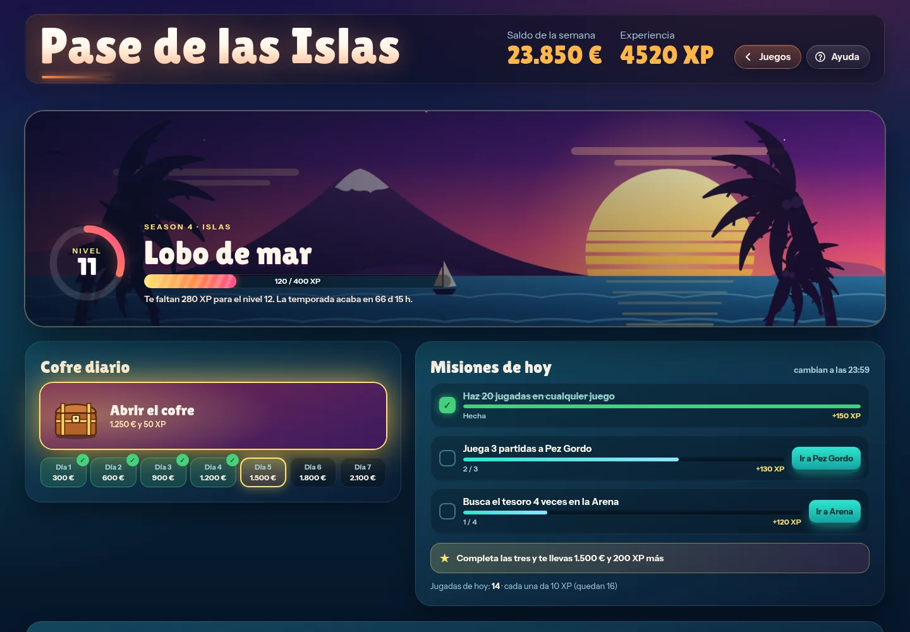</td>
    <td>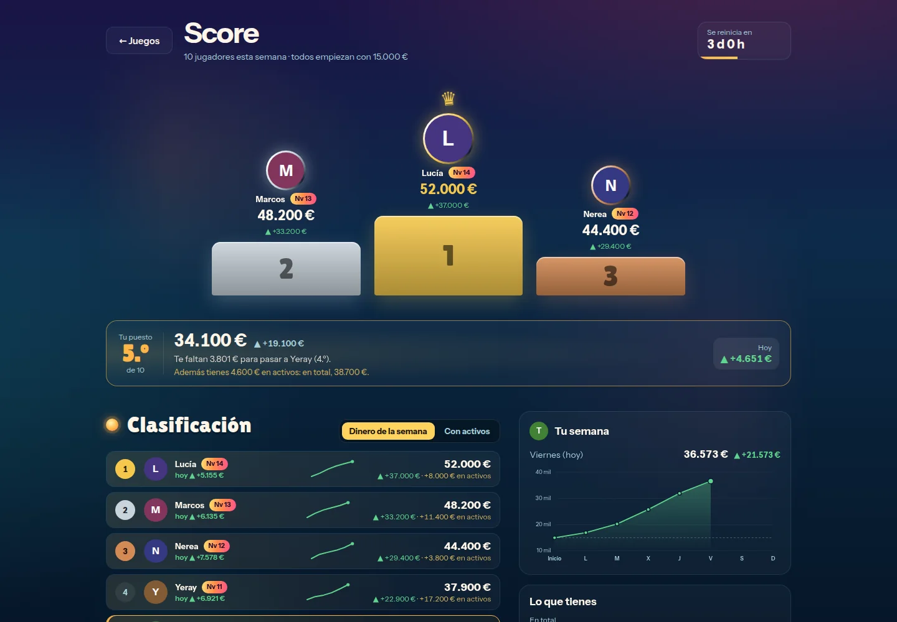</td>
  </tr>
  <tr>
    <td align="center"><b>Pase de las Islas</b> · misiones, cofre diario y niveles</td>
    <td align="center"><b>Score</b> · la clasificación de la semana</td>
  </tr>
  <tr>
    <td>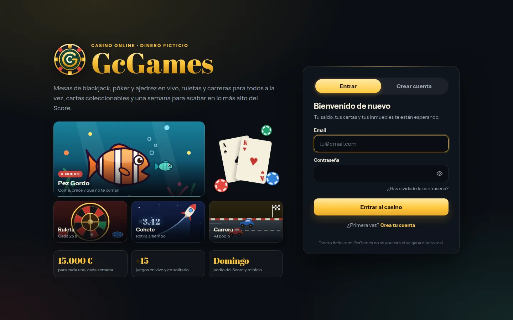</td>
    <td>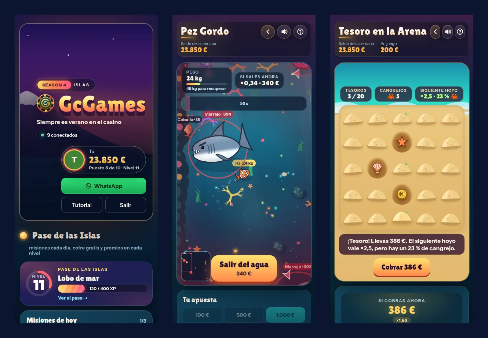</td>
  </tr>
  <tr>
    <td align="center">Entrada</td>
    <td align="center">En el móvil</td>
  </tr>
</table>

<sub>Capturas de la app con datos de ejemplo (jugadores y saldos inventados).</sub>

## 🃏 Juegos

| En vivo (mesas) | Para todos a la vez | En solitario | Economía |
|---|---|---|---|
| Blackjack | Regata (cada 44 s) | Pez Gordo | Gacha de cartas |
| Póker | Ruleta (cada 25 s) | Tesoro en la Arena | Inmobiliaria |
| Ajedrez | Cohete (cada 30 s) | Apnea | Cuenta en Suiza |
| | Carrera (cada 55 s) | La Torre | Hacienda |
| | Ascensor (cada minuto) | El Atraco | Casa de empeños |
| | La Subasta (cada minuto) | Plinko | |
| | Bingo | Rana | |
| | | Rasca de las Fiestas | |
| | | Mayor o Menor | |
| | | Bola Canaria | |

<details>
<summary><b>Qué es cada uno</b></summary>

**Mesas en vivo**
- **Blackjack**: hasta 7 jugadores contra el crupier.
- **Póker**: Texas Hold'em de hasta 6 jugadores, ciegas de 50 y 100 €.
- **Ajedrez**: uno contra uno con apuesta (amistosa o hasta 10.000 €), reloj de 5 minutos más 3 s por jugada, tablas
  y rendición. Tablero de piedra en perspectiva y piezas que revientan al capturarlas.

**Para todos a la vez**
- **Regata**: cinco veleros cada 44 s. Antes de cada regata sale el parte del tiempo: un clima (Despejado, Viento fuerte,
  Niebla, Tormenta, Remolino, Kraken, Calima o Arcoíris) que decide las probabilidades de cada velero y trae su propio
  espectáculo (rayos y lluvia, niebla que tapa la carrera, un remolino que hace girar y frena veleros, tentáculos del
  Kraken que atrapan a alguno…). El servidor sortea el orden de llegada completo (modelo Plackett-Luce) y se puede
  apostar al Ganador, a la Exacta (1.º y 2.º en orden) y al Trío (1.º, 2.º y 3.º en orden): cada resultado paga
  `0,96 / su probabilidad` (tope ×3.000), así que apuestes a lo que apuestes se recupera el 96 %. Los efectos del
  clima son coreografía y nunca cambian el orden ya sorteado.
- **Ruleta**: una tirada para todos cada 25 s.
- **Cohete**: sube para todos cada 30 s; retira antes de que explote.
- **Carrera**: una carrera cada 55 s; apuesta a un coche y cobra si acaba en el podio.
- **Ascensor**: todos suben y el premio crece en cada planta. Bájate antes de que se rompa el cable; el último en bajar
  se lleva el bonus.
- **La Subasta**: siete cajas misteriosas, pujas a la vista y prórroga en los últimos segundos. Puede ser el jackpot…
  o una piedra.
- **Bingo**: cartones para todos y un bote común que alimenta lo que se pierde en el resto del casino.

**En solitario**
- **Pez Gordo**: eres un pez payaso. Come plancton y peces más pequeños para crecer, huye de los tiburones y sal del agua
  cuando quieras: cuanto más pesas, más cobras (de ×0,28 a ×10). Si te comen, pierdes la apuesta.
- **Tesoro en la Arena**: una playa de 5×5 con 3, 5, 9 o 15 cangrejos escondidos. Cada hoyo con tesoro sube el premio
  y cobras cuando quieras; si sale un cangrejo, pierdes. Al acabar se ve dónde estaban todos.
- **Apnea**: aguanta la respiración mientras mantienes pulsado para bajar y suelta para subir. Cuanto más hondo llegues
  y consigas volver, más cobras. El tiburón aparece a una profundidad que el servidor sortea en secreto, y el aire de los
  pulmones se gasta bajando y subiendo (subir es el doble de lento): si sueltas demasiado abajo, te ahogas por el camino.
  Una marca en los pulmones te dice el aire que necesitas para volver. En Laguna, Arrecife o Abismo.
- **La Torre**: sube piso a piso sin pisar una baldosa rota, en cuatro dificultades.
- **El Atraco**: monta tu banda con tus cartas del gacha y baja planta a planta hasta la cámara acorazada.
- **Plinko**: suelta bolas y que caigan en las orillas.
- **Rana**: salta de nenúfar en nenúfar y cobra cuando quieras.
- **Rasca de las Fiestas**: cuatro cartones con su precio y su dibujo: Papas y Mojo (10 €, tres iguales, hasta ×500),
  Carnaval (50 €, números ganadores, hasta ×1.000), Ruta de las Islas (200 €, tres iguales con las siete islas, hasta
  ×100) y Drago de Oro (1.000 €, números, hasta ×100). Se rascan cogiendo la moneda y frotándola por encima: la capa
  plateada se borra por donde pasa. El cartón lo sortea el servidor al comprarlo.
- **Mayor o Menor**: con la baraja española, en la mesa de un guachinche. Dices si la siguiente carta será mayor o igual,
  o menor o igual; cada acierto multiplica el premio y cobras cuando quieras. Tres cambios de carta gratis por partida.
- **Bola Canaria**: coges tu bola, la estiras hacia atrás como un tirachinas y la sueltas: cuanto más estiras, más
  fuerte (arrimar, tiro medio o bochazo) y el ángulo decide hacia qué lado va. Cuanto más cerca del mingue se queda,
  más cobras; una arrimada de bochazo paga ×25.

</details>

## 🔧 Por dentro

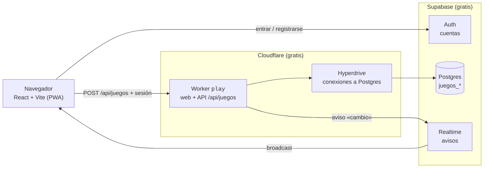

- **Sin servidor propio.** Cada acción es un `POST /api/juegos` al Worker con la sesión de Supabase. El Worker comprueba
  la firma del token con las claves públicas del proyecto (sin preguntar a Supabase Auth en cada petición), bloquea la
  fila con `FOR UPDATE`, aplica la jugada y guarda, todo en una transacción.
- **Mismas reglas en los dos lados.** Las reglas de cada juego son módulos puros en `src/juegos/<juego>/*.js`: la web los usa
  para pintar y el servidor (`api/_juegos/`) para sortear y pagar. No hay dos versiones que se puedan desincronizar.
- **El servidor decide.** Los sorteos usan `crypto.randomInt`, y lo que hay detrás de cada baldosa, hoyo o puerta se
  decide en el momento de pisar o cavar. Las rondas comunes (como el bingo) salen de un HMAC del número de ronda con un
  secreto del servidor, así todos ven la misma.
- **Partidas que se repiten en el servidor.** Pez Gordo es un juego de acción en tiempo real, y aun así es
  determinista: se juega en el navegador con la semilla que da el servidor (10 pasos por segundo, solo sumas, productos,
  divisiones, raíces y un generador de enteros), y al acabar llegan tus movimientos y el servidor repite la partida
  entera para pagar. Repetir una partida cuesta unos 4 ms de CPU y no se admiten más pasos de los que ha dado tiempo a
  jugar.
- **Juegos calibrados.** En La Torre y en Tesoro en la Arena el multiplicador de cada paso es `0,96 / probabilidad de
  llegar`, en la Apnea el premio a d metros es `0,96 / probabilidad de no cruzarte el tiburón hasta ahí` y en la Regata cada resultado (ganador, exacta o trío) paga
  `0,96 / su probabilidad`: hagas lo que hagas, de media se recupera el 96 %. Así el Score no se puede «cultivar» a base de jugar mucho.
- **Tiempo real barato.** Cuando algo cambia, el servidor manda un aviso sin datos por Supabase Realtime y cada
  navegador pide su propia vista: nadie recibe las cartas tapadas de los demás. Fuera de las mesas, el sondeo es solo un
  respaldo (cada 60 s, y nunca con la pestaña oculta), y lo que es igual para todos se guarda unos segundos en el Worker.
- **Temporizadores sin cron.** Los turnos y el crupier los hacen avanzar los propios navegadores cuando vencen (`tick`):
  primero el que tiene el turno y, por si su pestaña está dormida, los demás un poco después.
- **El esquema se mantiene solo.** Las tablas `juegos_*` las crea el servidor la primera vez, y las ampliaciones (por
  ejemplo, cuando llega un juego nuevo) se aplican al arrancar si faltan. Los juegos retirados devuelven o pagan lo que
  quedara a medias.

## 📁 Estructura

```
.
├── src/
│   ├── main.jsx, App.jsx    # Arranque, sesión y rutas
│   ├── entrada/             # Entrar, crear cuenta, cambiar la contraseña, cuenta pendiente
│   ├── hooks/useAuth.jsx    # Sesión de Supabase y perfil (get_mi_perfil)
│   ├── lib/supabase.js      # Cliente de Supabase
│   └── juegos/              # El casino
│       ├── Juegos.jsx       # Selector de juegos y pantallas
│       ├── useJuegos.js     # Conexión con el servidor
│       ├── <juego>/         # Un juego por carpeta (roulette/, crash/, race/, fish/, dig/…): su pantalla
│       │                    #   (*.jsx, *.css), su arte y sus reglas puras (*.js, las comparte el servidor)
│       ├── hub/             # Selector: tarjetas, clasificación y guía
│       ├── comun/           # Piezas compartidas: avatar, ayuda, premios, sonido, dinero, cartas
│       ├── estilos/         # Estilos base y la cabecera y el fondo de cada juego
│       ├── temas/           # Temas de temporada que se encienden por fechas (Halloween)
│       ├── table/, poker/, chess/   # Mesas en vivo
│       ├── banca/           # Panel del master y Hacienda
│       ├── shared/          # Núcleo de blackjack, póker y ajedrez
│       └── season4/         # Tema de las islas, el pase y las ilustraciones nuevas
├── api/_juegos/             # Servidor: un módulo por juego, banca, Hacienda, pase, auth y base de datos
│   └── engine/              # Motor de las mesas en vivo, temporizadores y semana
├── worker.mjs               # Entrada del Worker de Cloudflare
├── wrangler.jsonc           # Configuración del Worker (assets, Hyperdrive, variables)
├── public/                  # Iconos (salen de src/assets/logo.svg) y _headers (cabeceras de seguridad)
├── supabase/                # SQL base y migraciones
├── scripts/                 # Catálogo del gacha y copia de datos
├── docs/                    # Planes de diseño y capturas del README
└── .github/workflows/       # Publicación automática
```

## 🚀 Puesta en marcha

Requisitos: Node.js 22 o superior.

```bash
git clone https://github.com/Haise232/GcGames.git
cd GcGames
npm install
npm run dev          # la web en http://localhost:5174
```

`npm run dev` sirve solo la web (contra el Supabase de `.env.production`). Para probar también la API en local:

```bash
npm run dev:worker   # vite build + wrangler dev
```

### Variables de entorno

| Variable | Dónde | Para qué |
|---|---|---|
| `VITE_SUPABASE_URL` | `.env.production` y `wrangler.jsonc` | URL del proyecto de Supabase (pública) |
| `VITE_SUPABASE_ANON_KEY` | `.env.production` y `wrangler.jsonc` | Clave pública de Supabase |
| `JUEGOS_DATABASE_URL` | Secreto del Worker (`wrangler secret put`) | Pooler de Supabase con el rol `juegos_api`; también siembra la ruleta |
| `JUEGOS_RULETA_SECRET` | Secreto del Worker (opcional) | Semilla propia para la ruleta en vivo |

El Worker se conecta a Postgres por **Hyperdrive** (`wrangler.jsonc`), no con `JUEGOS_DATABASE_URL`: el TLS de los
Workers no acepta el certificado del pooler de Supabase y Hyperdrive, además, mantiene las conexiones abiertas. La caché
de consultas de Hyperdrive está **desactivada** (un juego no puede leer saldos viejos).

## ☁️ Publicar

Cada push a `main` compila y publica el Worker con GitHub Actions (`.github/workflows/deploy.yml`). Necesita en el
repositorio los secretos `CLOUDFLARE_API_TOKEN` y `CLOUDFLARE_ACCOUNT_ID`.

A mano:

```bash
npm run deploy       # vite build + wrangler deploy
```

## 🗄️ Base de datos

Supabase (proyecto propio de GcGames).

- `supabase/00_base.sql`: tabla `usuarios`, el trigger que crea la fila al registrarse (como *pendiente*),
  `get_mi_perfil()` y el rol `juegos_api` con su política sobre `usuarios`.
- Las tablas `juegos_*` (cuentas, mesas, rondas, chat, gacha, inmuebles, Suiza, pase, avisos…) las crea el propio
  servidor la primera vez desde `api/_juegos/schema.mjs`. Son del rol `juegos_api`; todas tienen RLS sin políticas, así
  que desde el navegador no se puede leer ni escribir nada: solo el Worker.
- Las migraciones de `supabase/migracion_*.sql` también las aplica el servidor solo si faltan; se pueden ejecutar a mano
  más de una vez.
- Al añadir una tabla nueva en una migración: `alter table … owner to juegos_api` y quitar permisos a `anon`,
  `authenticated` y `service_role`.

## 👥 Cuentas y administración

- Cualquiera puede crear una cuenta, pero queda **pendiente** hasta que el master la acepta en **la banca → Cuentas**.
- El master es la cuenta con `usuarios.es_superadmin = true` (solo hay una). Es el único que ve el botón de la banca.
- **La banca → Usuarios** lista todas las cuentas con su email, su estado y su último acceso. Si alguien olvida la
  contraseña, el master le pone una **temporal** (12 caracteres al azar que genera el servidor y que solo se ven una vez):
  se le cierran las sesiones abiertas y, al entrar con ella, tiene que elegir una nueva antes de jugar (el servidor no le
  deja jugar hasta entonces). Funciones en `supabase/01_usuarios_password.sql`; solo las puede llamar `juegos_api`.
- «He olvidado la contraseña» manda un enlace por email; en Supabase → Authentication → URL Configuration la *Site URL*
  tiene que ser `https://play.gcgames.workers.dev`.

## 🔒 Seguridad

- Todo lo que vale dinero lo decide el servidor: los sorteos usan `crypto.randomInt` y las reglas puras de cada juego;
  el navegador solo pinta (y, en Pez Gordo, manda movimientos que el servidor repite).
- Las sesiones se verifican con las claves públicas (JWKS) del proyecto con WebCrypto.
- RLS en todas las tablas; el navegador solo puede llamar a `get_mi_perfil()`.
- Cabeceras en `public/_headers`: CSP (`default-src 'self'`, conexiones solo a `*.supabase.co`), HSTS,
  `X-Frame-Options: DENY`, `nosniff`, `Referrer-Policy` y `Permissions-Policy`.

## 📊 Límites del plan gratuito

| Servicio | Límite | Qué pasa si se pasa |
|---|---|---|
| Cloudflare Workers | 100.000 peticiones al día, 10 ms de CPU por petición | Las peticiones fallan hasta medianoche (UTC); no hay cobros |
| Cloudflare Hyperdrive | 100.000 consultas al día | Igual |
| Supabase | 500 MB de base de datos, 50.000 usuarios activos al mes | Avisos y, en el peor caso, pausa del proyecto |

El consumo se ve en el panel de Cloudflare (Workers → `play` → Métricas) y en el de Supabase.

---

<div align="center">
<sub>Dinero ficticio: en GcGames no se apuesta ni se gana dinero real.</sub>
</div>
