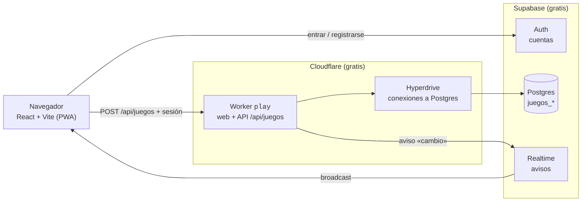

<div align="center">


# GcGames

**Un casino online para jugar con tu gente: mesas en vivo, juegos para todos a la vez, gacha de cartas y una economía semanal con su propia Hacienda.**

[](https://play.gcgames.workers.dev)


</div>

---

## Índice

- [Qué es](#-qué-es)
- [Juegos](#-juegos)
- [Cómo funciona](#️-cómo-funciona)
- [Estructura](#-estructura)
- [Puesta en marcha](#-puesta-en-marcha)
- [Publicar](#-publicar)
- [Base de datos](#️-base-de-datos)
- [Cuentas y administración](#-cuentas-y-administración)
- [Seguridad](#-seguridad)
- [Límites del plan gratuito](#-límites-del-plan-gratuito)

---

## 🎲 Qué es

GcGames es un casino con dinero de mentira para un grupo cerrado. Cada jugador empieza la semana con **15.000 €**;
el domingo a las 23:59 (hora de Canarias) se reinician los saldos y se guarda el podio de la semana.

- **Mesas en vivo** de blackjack y póker, con chat, globos de mensaje y enlaces de invitación.
- **Juegos para todos a la vez**: una ronda común cada pocos segundos que todos ven igual.
- **Juegos en solitario** que sortea el servidor (nadie puede hacer trampas desde el navegador).
- **Score** semanal con la evolución día a día y lo que cada uno tiene en activos (cartas, inmuebles, Suiza).
- **Economía**: gacha de cartas coleccionables (con casa de empeños), Inmobiliaria con tablero, Cuenta en Suiza para
  esconder dinero y **Hacienda**, que reclama su parte a los que más tienen.
- **La banca**: el master puede dar dinero, mandar mensajes, activar el *Admin Abuse* (×2, ×3 o todo gratis), abrir el
  bote del bingo, lanzar redadas de Hacienda y aceptar las cuentas nuevas.
- App instalable en el móvil (PWA) y tema de Halloween en fechas.

## 🃏 Juegos

| En vivo (mesas) | Para todos a la vez | En solitario | Economía |
|---|---|---|---|
| Blackjack | Ruleta (cada 25 s) | Laberinto | Gacha de cartas |
| Póker | Cohete (cada 30 s) | Plinko | Inmobiliaria |
| | Carrera (cada 55 s) | Rana | Cuenta en Suiza |
| | Ascensor | La Torre | Hacienda |
| | La Subasta | El Atraco | Duelos |
| | El Puente de Cristal | | |
| | Bingo | | |

## ⚙️ Cómo funciona



- **Sin servidor propio.** Cada acción es un `POST /api/juegos` al Worker con la sesión de Supabase. El Worker comprueba
  la firma del token (con las claves públicas del proyecto, sin preguntar a Supabase Auth en cada petición), carga la
  mesa de Postgres con bloqueo (`FOR UPDATE`), aplica la jugada y guarda.
- **Tiempo real.** Cuando algo cambia, el servidor manda un aviso por Supabase Realtime (sin datos) y cada navegador
  pide su propia vista: nadie recibe las cartas tapadas de los demás.
- **Temporizadores.** Los turnos y el crupier los hacen avanzar los propios navegadores cuando vencen (`tick`); primero
  el que tiene el turno y, por si su pestaña está dormida, los demás un poco después.
- **Mismas reglas en los dos lados.** Las reglas de cada juego son módulos puros en `src/juegos/*.js`: la web los usa
  para pintar y el servidor (`api/_juegos/`) para sortear y pagar.
- **Pocas peticiones.** Fuera de las mesas, Realtime avisa de los cambios y el sondeo es solo un respaldo (cada 60 s, y
  nunca con la pestaña oculta). Lo que es igual para todos (mesas del selector, Score) se guarda unos segundos en el Worker.

## 📁 Estructura

```
.
├── src/
│   ├── main.jsx, App.jsx    # Arranque, sesión y rutas
│   ├── entrada/             # Entrar, crear cuenta, cambiar la contraseña, cuenta pendiente
│   ├── hooks/useAuth.jsx    # Sesión de Supabase y perfil (get_mi_perfil)
│   ├── lib/supabase.js      # Cliente de Supabase
│   └── juegos/              # El casino: selector, cada juego, mesas, póker, banca, gacha…
├── api/_juegos/             # Servidor: un módulo por juego, banca, Hacienda, auth y base de datos
│   └── engine/              # Motor de las mesas en vivo (blackjack y póker)
├── worker.mjs               # Entrada del Worker de Cloudflare
├── wrangler.jsonc           # Configuración del Worker (assets, Hyperdrive, variables)
├── public/                  # Iconos (salen de src/assets/logo.svg) y _headers (cabeceras de seguridad)
├── supabase/00_base.sql     # Tabla usuarios, alta automática y rol juegos_api
├── scripts/                 # Catálogo del gacha y copia de datos
└── .github/workflows/       # Publicación automática
```

## 🚀 Puesta en marcha

Requisitos: Node.js 22 o superior.

```bash
git clone https://github.com/Haise232/GcGames.git
cd GcGames
npm install
npm run dev          # la web en http://localhost:5174
```

`npm run dev` sirve solo la web (contra el Supabase de `.env.production`). Para probar también la API en local:

```bash
npm run dev:worker   # vite build + wrangler dev
```

### Variables de entorno

| Variable | Dónde | Para qué |
|---|---|---|
| `VITE_SUPABASE_URL` | `.env.production` y `wrangler.jsonc` | URL del proyecto de Supabase (pública) |
| `VITE_SUPABASE_ANON_KEY` | `.env.production` y `wrangler.jsonc` | Clave pública de Supabase |
| `JUEGOS_DATABASE_URL` | Secreto del Worker (`wrangler secret put`) | Pooler de Supabase con el rol `juegos_api`; también siembra la ruleta |
| `JUEGOS_RULETA_SECRET` | Secreto del Worker (opcional) | Semilla propia para la ruleta en vivo |

El Worker se conecta a Postgres por **Hyperdrive** (`wrangler.jsonc`), no con `JUEGOS_DATABASE_URL`: el TLS de los
Workers no acepta el certificado del pooler de Supabase y Hyperdrive, además, mantiene las conexiones abiertas. La caché
de consultas de Hyperdrive está **desactivada** (un juego no puede leer saldos viejos).

## ☁️ Publicar

Cada push a `main` compila y publica el Worker con GitHub Actions (`.github/workflows/deploy.yml`). Necesita en el
repositorio los secretos `CLOUDFLARE_API_TOKEN` y `CLOUDFLARE_ACCOUNT_ID`.

A mano:

```bash
npm run deploy       # vite build + wrangler deploy
```

## 🗄️ Base de datos

Supabase (proyecto propio de GcGames).

- `supabase/00_base.sql`: tabla `usuarios`, el trigger que crea la fila al registrarse (como *pendiente*),
  `get_mi_perfil()` y el rol `juegos_api` con su política sobre `usuarios`.
- Las tablas `juegos_*` (cuentas, mesas, rondas, chat, gacha, inmuebles, Suiza, avisos…) las crea el propio servidor
  la primera vez desde `api/_juegos/schema.mjs`. Son del rol `juegos_api`; todas tienen RLS sin políticas, así que
  desde el navegador no se puede leer ni escribir nada: solo el Worker.
- Al añadir una tabla nueva en una migración: `alter table … owner to juegos_api` y quitar permisos a `anon`,
  `authenticated` y `service_role`.

## 👥 Cuentas y administración

- Cualquiera puede crear una cuenta, pero queda **pendiente** hasta que el master la acepta en **la banca → Cuentas**.
- El master es la cuenta con `usuarios.es_superadmin = true` (solo hay una). Es el único que ve el botón de la banca.
- «He olvidado la contraseña» manda un enlace por email; en Supabase → Authentication → URL Configuration la *Site URL*
  tiene que ser `https://play.gcgames.workers.dev`.

## 🔒 Seguridad

- Todo lo que vale dinero lo decide el servidor: los sorteos usan `crypto.randomInt` y las reglas puras de cada juego;
  el navegador solo pinta.
- Las sesiones se verifican con las claves públicas (JWKS) del proyecto con WebCrypto.
- RLS en todas las tablas; el navegador solo puede llamar a `get_mi_perfil()`.
- Cabeceras en `public/_headers`: CSP (`default-src 'self'`, conexiones solo a `*.supabase.co`), HSTS,
  `X-Frame-Options: DENY`, `nosniff`, `Referrer-Policy` y `Permissions-Policy`.

## 📊 Límites del plan gratuito

| Servicio | Límite | Qué pasa si se pasa |
|---|---|---|
| Cloudflare Workers | 100.000 peticiones al día, 10 ms de CPU por petición | Las peticiones fallan hasta medianoche (UTC); no hay cobros |
| Cloudflare Hyperdrive | 100.000 consultas al día | Igual |
| Supabase | 500 MB de base de datos, 50.000 usuarios activos al mes | Avisos y, en el peor caso, pausa del proyecto |

El consumo se ve en el panel de Cloudflare (Workers → `play` → Métricas) y en el de Supabase.
